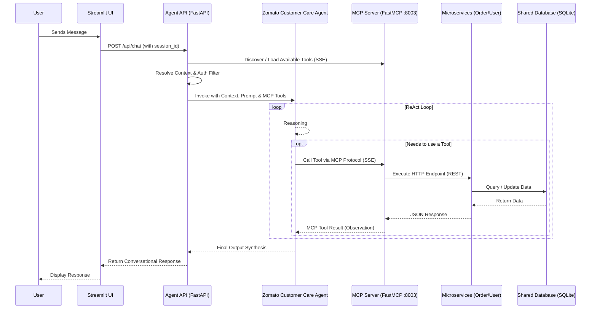

# Architecture Overview

This project implements a distributed microservices system for the Zomato AI Customer Care ecosystem. It utilizes **FastAPI** for backend microservices, **LangChain** for autonomous agent orchestration, **Streamlit** for the frontend interface, and **SQLite** for data persistence.

## System Components

### 1. The Frontend (Streamlit)
Located in `frontend/`, this service provides an interactive chat interface mimicking a customer support portal.
- **Session Identification**: Automatically generates a unique `session_id` to persist conversation history context across HTTP calls.
- **Communication**: Interacts exclusively with the Agent Microservice via REST (`POST /api/chat`).

### 2. The Agent Orchestrator (FastAPI + LangChain)
Located in `agent/`, this is the "brain" of the ecosystem. (Runs on port `8000`)

#### Agent Architecture
- **ReAct Architecture (Reasoning + Acting)**: The agent operates on an asynchronous ReAct loop where it evaluates user queries, determines the required tools to fulfill the intent, and iteratively refines its responses based on tool feedback.
- **Memory & Context Management**: The agent maintains conversation history tied to a `session_id`. An in-memory store in `session_manager.py` tracks active sessions and maps them to authenticated user identities. Idle sessions are purged after 5 minutes of inactivity to conserve resources.
- **Dynamic System Prompts**: The core logic generates a dynamic `system_prompt` injected into the LLM context. This prompt is conditional on the user's authentication state, explicitly forbidding the LLM from executing secure operations (like order cancellation or refund processing) unless the user has successfully passed OTP verification.
- **MCP Client Integration**: Instead of bundling tool logic directly or calling microservices, the Agent queries the dedicated **MCP Server** over SSE (`http://mcp_server:8003/sse`) using `langchain-mcp-adapters` (`MultiServerMCPClient`). Tools are dynamically loaded from the MCP server and mapped into LangChain tools.

### 3. The Model Context Protocol (FastMCP) Service
Located in `mcp_server/`, this service standardizes all tool capabilities into an MCP-compliant server. (Runs on port `8003`)
- **FastMCP Protocol**: Implements official Anthropic FastMCP with Server-Sent Events (SSE) transport.
- **Tool Catalog**: Exposes 15 domain tools (`send_otp`, `verify_otp`, `get_orders`, `cancel_order`, `track_driver`, etc.) with rich parameter schemas.
- **Microservice Invocation**: The MCP server is the single point of contact executing REST calls against the downstream Order and User microservices.
- **Observability**: Intercepts and logs all tool invocations and outbound HTTP calls.

### 4. Order Management Microservice (FastAPI)
Located in `mock_services/zomato_order_service/`, this API isolates all order-related domain logic. (Runs on port `8001`)

#### Service Details
- **Order Lifecycle Endpoints**: Exposes REST endpoints to fetch active order details, track driver ETA, fetch specific order items, process address modifications, and cancel ongoing orders.
- **Driver Communication**: Provides a mock SMS endpoint that simulates dispatching messages to delivery partners (e.g. "Leave order at the door").
- **Complaint Handling & Compensation**: Implements intelligent evaluation of user complaints (e.g. missing items, cold food). If the complaint is valid based on business rules, this microservice autonomously communicates with the User Management Service to trigger financial refunds directly into the user's Zomato Wallet.

### 5. User Management Microservice (FastAPI)
Located in `mock_services/zomato_user_management_service/`, this API centralizes customer identities, authentication, and finances. (Runs on port `8002`)

#### Service Details
- **Authentication (OTP Flow)**: Manages mock OTP generation, dispatch (logging to console), and validation. The agent microservice relies entirely on this service to establish secure trust.
- **Wallet & Finance Operations**: Controls the user's Zomato Wallet ledger. Provides endpoints to fetch current balance and securely processes credit requests (e.g. automated compensation refunds invoked by the Order Service).
- **Subscription Management**: Manages user subscription tiers (e.g. Zomato Gold). Generates mock payment links when users request renewals, providing a seamless transactional flow.

### 6. Shared Mock Database (SQLite)
Located in `mock_services/data/zomato_mock.db`, this database acts as the single source of truth for the mock environment.
- **Relational Tables**: It maintains distinct schemas for `customers`, `orders`, `order_items`, `payments`, and `complaints`.
- **Automated Seeding**: The initialization script `database.py` heavily seeds this database with dynamic, interconnected mock data upon container launch to ensure a rich testing environment.

## Agent Execution Flow

1. **User Request**: The user submits a message via the Streamlit UI, which is forwarded to `/api/chat`.
2. **Context Resolution**: The `agent/main.py` checks if the `session_id` is currently authenticated.
3. **Tool Resolution via MCP**: The Agent retrieves tools from the **FastMCP Server** over SSE. Unauthenticated sessions are restricted to OTP tools (`send_otp`, `verify_otp`).
4. **Reasoning & Tool Selection**: The LLM analyzes the request and decides if it needs to act autonomously using a tool (e.g., calling `track_driver(order_id="ORD123")`).
5. **Tool Execution through MCP**: When a tool is triggered, LangChain sends the tool call to the **FastMCP Server** (`:8003`). The MCP server executes the corresponding REST request against the target microservice (`:8001` or `:8002`), which accesses SQLite. The MCP server returns the formatted response back to the LLM.
6. **Final Output Synthesis**: The LLM synthesizes a final conversational response and returns it to the Streamlit UI.
